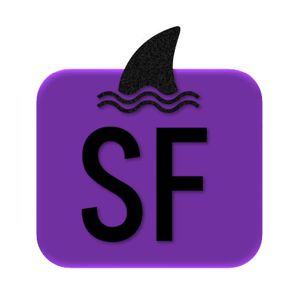

<h1 align="center">🦈 SharkFlix</h1>

<p align="center">
  
</p>

<p align="center">
  
  
  
  
  
  
</p>

## 🚀 Demo ao Vivo

**Acesse o site em produção:** [https://leoachaves.github.io/SharkFlix/](https://leoachaves.github.io/SharkFlix/)

---

## 📋 Sobre o Projeto

**SharkFlix** é uma plataforma de streaming de filmes e séries desenvolvida como projeto de módulo do curso Web Dev Full Stack da [Resilia Educação](https://www.resilia.com.br/). O projeto integra a **API OMDB** para consulta de informações de filmes e a **API ViaCEP** para autocompletar endereços no cadastro.

---

## ✨ Funcionalidades

### 🏠 Página Inicial

- **Carrossel de destaques** com filmes populares
- **Cards de filmes** com informações resumidas
- **Modais com detalhes** (sinopse, elenco, trailer, etc.)
- **Redirecionamento** para páginas de informações

### 🔍 Pesquisa

- Busca de filmes por título via API OMDB
- Exibição de resultados com:
  - Pôster do filme
  - Título e ano
  - Sinopse, gênero, duração e avaliação IMDB

### 📝 Cadastro de Usuários

- **Validação de email** (formato e caracteres)
- **Validação de senha** (confirmação)
- **Busca automática de endereço por CEP** (ViaCEP API)
- **Seleção de planos** (Básico, Premium, Shark)

### 🔐 Login e Recuperação de Senha

- Autenticação básica com email/senha
- Sistema de recuperação de senha (frontend)

### 📱 Contato

- Cards com informações dos desenvolvedores
- Formulário de contato com validação
- Links para GitHub, LinkedIn, email e telefone

---

## 🛠️ Tecnologias Utilizadas

| Tecnologia            | Descrição                             |
| --------------------- | ------------------------------------- |
| **HTML5**             | Estrutura das páginas                 |
| **CSS3**              | Estilização personalizada             |
| **Bootstrap 5**       | Layout responsivo e componentes       |
| **JavaScript (ES6+)** | Lógica da aplicação                   |
| **jQuery 3.6**        | Manipulação do DOM e requisições AJAX |
| **OMDB API**          | Consulta de informações de filmes     |
| **ViaCEP API**        | Busca de endereços por CEP            |

---

## 🎨 APIs Utilizadas

### OMDB API

```javascript
// Endpoint para busca de filmes
https://www.omdbapi.com/?s={titulo}&apikey=3168fe11

// Endpoint para detalhes do filme
https://www.omdbapi.com/?i={imdbID}&apikey=3168fe11
```

### ViaCEP API

```javascript
// Endpoint para busca de CEP
https://viacep.com.br/ws/{cep}/json/
```

---

## 🚀 Como Executar o Projeto

### Acessar online

Acesse: [https://leoachaves.github.io/SharkFlix/](https://leoachaves.github.io/SharkFlix/)

### Executar localmente

```bash
# Clone o repositório
git clone https://github.com/LeoAChaves/SharkFlix.git

# Entre na pasta
cd SharkFlix

# Abra o arquivo no navegador (pasta src)
open index.html
```

---

## 👥 Autores

<table align="center">
  <tr>
    <td align="center">
      
      <br />
      <sub><b>Filipe Ribeiro</b></sub>
      <br />
      <a href="https://github.com/FilpeRibeiro">🐙</a>
      <br />
      <a href="https://www.linkedin.com/in/filipe-martins-2502bb223/">🔗</a>
    </td>
    <td align="center">
      
      <br />
      <sub><b>Jhack Costa</b></sub>
      <br />
      <a href="https://github.com/JhackCosta">🐙</a>
      <br />
      <a href="https://www.linkedin.com/in/jhack-rychard-de-oliveira-costa-6543251a1/">🔗</a>
    </td>
    <td align="center">
      
      <br />
      <sub><b>Leonardo Chaves</b></sub>
      <br />
      <a href="https://github.com/LeoAChaves">🐙</a>
      <br />
      <a href="https://www.linkedin.com/in/leonardo-chaves-b6544b229/">🔗</a>
    </td>
    <td align="center">
      
      <br />
      <sub><b>Wandberg de Lima</b></sub>
      <br />
      <a href="https://github.com/wandbergdelima">🐙</a>
      <br />
      <a href="https://www.linkedin.com/in/wandberg-de-lima-1a5a52177/">🔗</a>
    </td>
    <td align="center">
      
      <br />
      <sub><b>Yago Rodrigues</b></sub>
      <br />
      <a href="https://github.com/yagormorares">🐙</a>
      <br />
      <a href="https://www.linkedin.com/in/yagordmoraes/">🔗</a>
    </td>
  </tr>
</table>

---

## 📝 Licença

Este projeto está sob a licença MIT.

---

<div align="center">
  <strong>
    <a href="https://leoachaves.github.io/SharkFlix/">🦈 Acessar SharkFlix</a>
  </strong>
  <br>
  <br>
  
  <br>
  <em>"Mergulhe no mundo do entretenimento"</em>
  <br>
  Desenvolvido com 🎬 e 🦈.
</div>

---
